# Mailwerk – E-Mail-App für Android

Eine eigene Mail-App (wie Outlook), die die besten Ideen aus den bekannten Mail-Apps zusammenführt.
Sie läuft **komplett auf dem Gerät**: keine Cloud, kein Konto beim App-Hersteller, keine Werbung.

**Download:** [`Mailwerk.apk`](Mailwerk.apk) (Android 8.0 oder neuer) · **Veröffentlichen im Play Store:** [VEROEFFENTLICHEN.md](VEROEFFENTLICHEN.md) ·
**Datenschutz:** [DATENSCHUTZ.md](DATENSCHUTZ.md)

Sprachen: **Englisch** (Standard) und **Deutsch** – die App folgt automatisch der Sprache des Handys.

Mailwerk ist ein neutrales Produkt: keine Daten des Entwicklers in der App, jeder meldet sich mit seinem eigenen Konto an –
per Passwort (jeder IMAP-Anbieter) oder über das Anmeldefenster von **Google** bzw. **Microsoft** (OAuth, sobald die
Client-IDs in `mailwerk.properties` eingetragen sind).

| Posteingang | Unterhaltung | Antworten | Einstellungen |
|---|---|---|---|
| 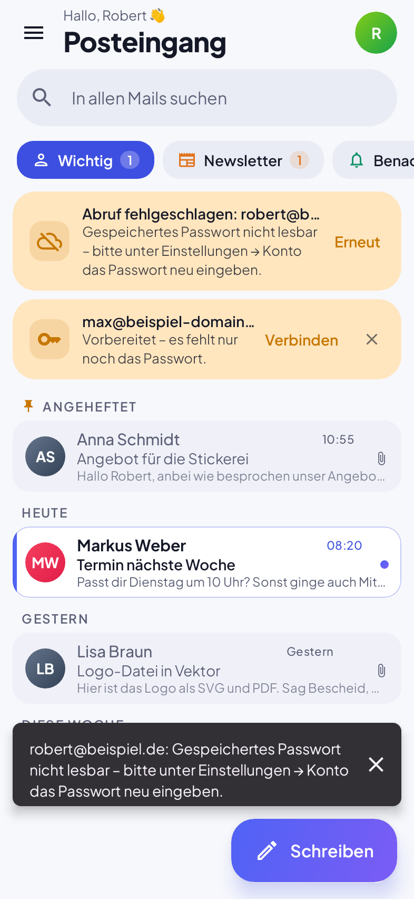 | 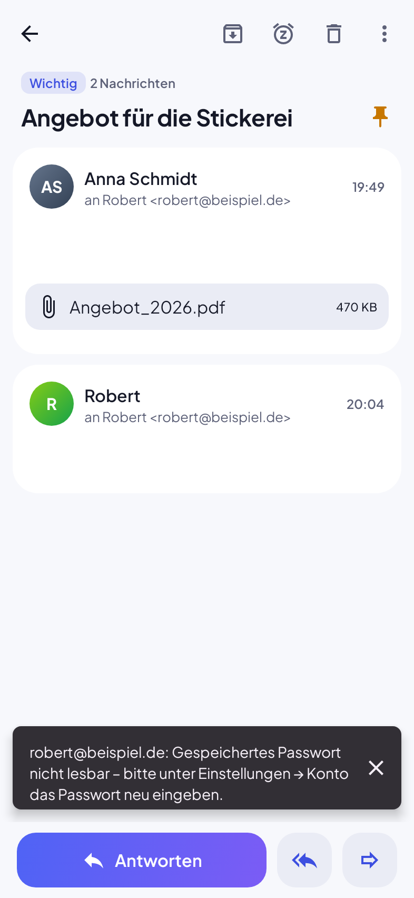 | 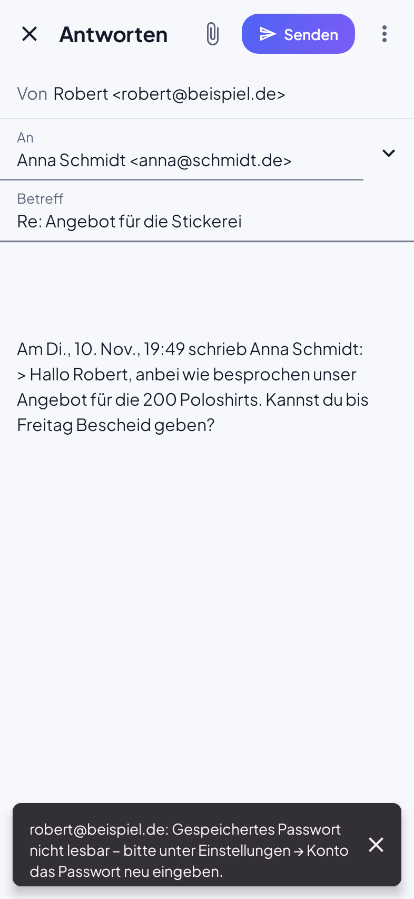 | 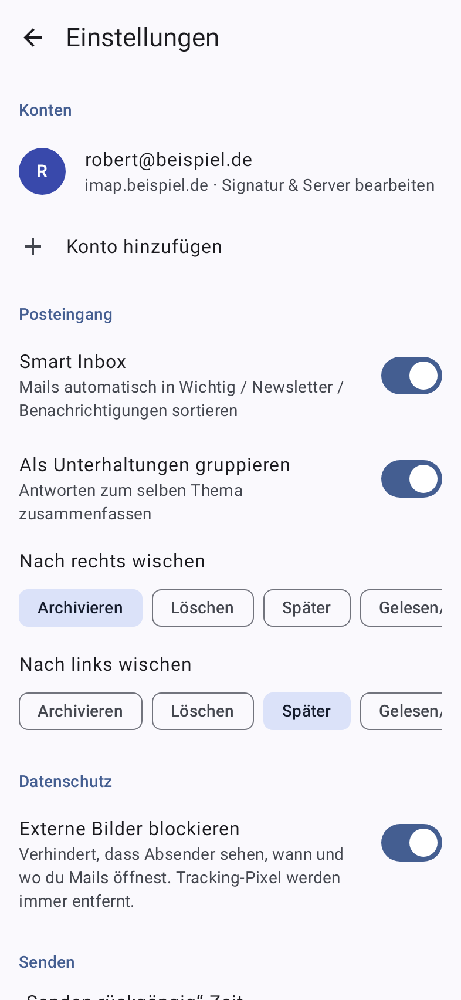 |

| Dunkelmodus | | Hinweise (Update, Konto) | Newsletter-Tab |
|---|---|---|---|
| 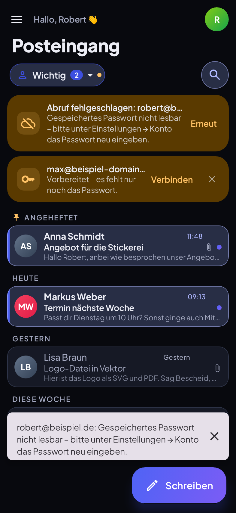 | 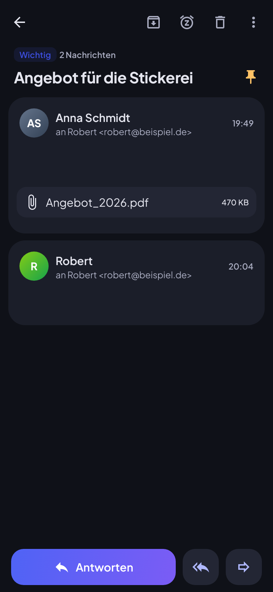 | 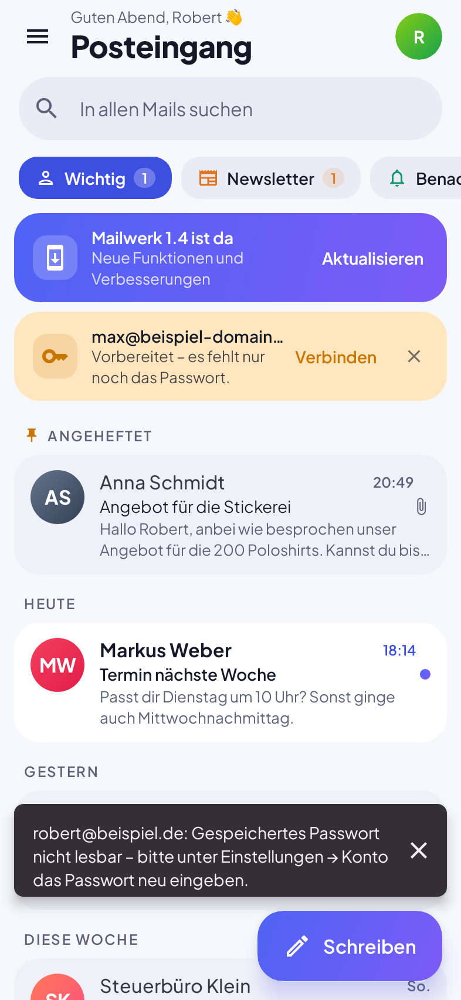 | 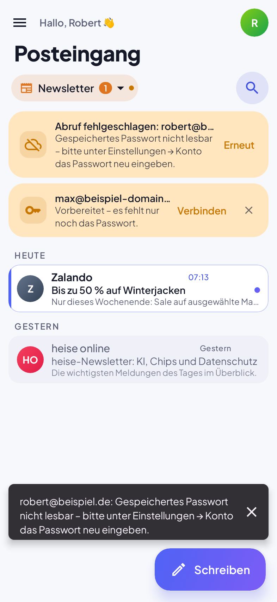 |

Design: eigene Farbwelt (Indigo/Violett-Verlauf), Schrift *Plus Jakarta Sans* (SIL OFL, siehe `licenses/`),
Karten-Layout mit Datumsgruppen, farbige Kategorie-Tabs, heller und dunkler Modus. Optional „Farben vom Hintergrundbild“ (Material You).

## Was aus welcher App übernommen wurde

| Funktion | Vorbild | In Mailwerk |
|---|---|---|
| Smart Inbox: Wichtig / Newsletter / Benachrichtigungen | Spark, Gmail-Tabs, Outlook „Relevant“ | ✅ Automatisch, lokal; pro Absender umstellbar |
| Gemeinsamer Posteingang für alle Konten | Spark, BlueMail, FairEmail | ✅ |
| Zurückstellen („Snooze“) | Gmail, Spark, Outlook | ✅ mit Schnellwahl und Wunschtermin |
| Später senden | Gmail, Outlook, Spark | ✅ |
| Senden rückgängig | Gmail | ✅ 5–30 Sekunden, einstellbar |
| Erinnern, falls keine Antwort | Superhuman, Spark, Gmail „Nudges“ | ✅ beim Senden oder nachträglich |
| Anheften (Pins) | Spark | ✅ angeheftete Mails stehen oben |
| Wischgesten frei belegbar | Outlook, Gmail, Spark | ✅ Archiv, Löschen, Später, Gelesen, Anheften |
| Tracking-Pixel blockieren | HEY, FairEmail, Apple Mail | ✅ immer aktiv, mit Anzeige „x Tracker blockiert“ |
| Externe Bilder erst auf Wunsch laden | FairEmail, Thunderbird | ✅ |
| Newsletter mit einem Tipp abbestellen | Gmail, Spark | ✅ inkl. RFC 8058 One-Click |
| Absender blockieren / einsortieren | HEY Screener | ✅ |
| Benachrichtigung nur bei wichtigen Mails | Spark „Smart Notifications“ | ✅ |
| Unterhaltungsansicht | Gmail, Outlook | ✅ inkl. eigener Antworten aus „Gesendet“ |
| Vorlagen / Schnellantworten | Spark, Outlook | ✅ |
| Kontaktvorschläge beim Schreiben | alle | ✅ nach Häufigkeit sortiert |
| Automatische Servererkennung | Thunderbird | ✅ Anbieter-Liste + Mozilla-ISPDB + autoconfig |
| Material You, Dunkelmodus | Gmail | ✅ |
| Als Standard-Mail-App, Teilen aus anderen Apps | – | ✅ `mailto:`-Links und „Teilen“ mit Anhängen |
| Passwörter im Hardware-Schlüsselspeicher | FairEmail | ✅ Android-Keystore (AES-GCM) |
| Eigene Ordner anlegen, umbenennen, löschen (auch im Posteingang) | Outlook | ✅ direkt auf dem Server |
| Lesebestätigung anfordern / senden | Outlook | ✅ „✓✓ Gelesen am …“ an der gesendeten Mail |
| Termine aus Einladungen in den **Familienkalender** – in der Farbe des Empfängers | – | ✅ siehe unten |
| JavaScript in Mails | – | ❌ grundsätzlich aus (Sicherheit) |

## Familienkalender

Mailwerk lässt sich mit dem gemeinsamen **Familienkalender** (eigene Kalender-App mit Server) verknüpfen:
Einstellungen → **Familienkalender** → Einladung aus der Kalender-App einfügen (Server + Gruppen-Code) → Verbinden.
Danach legt man pro Postfach fest, wem es gehört (wird über den Vornamen meist automatisch erkannt).
Die Server-Adresse muss niemand kennen: Der Kalender-Server ist fest hinterlegt (`calendar.url` in `mailwerk.properties`),
es reicht der Gruppen-Code. Liegt die Einladung in der Zwischenablage oder kam sie per Mail, findet Mailwerk sie selbst
(„✨ Einladung gefunden → Jetzt verbinden“); in der Einladungs-Mail gibt es außerdem direkt den Knopf „Familienkalender verbinden“.

- Kommt eine **Termin-Einladung per Mail** (Outlook, Gmail, iCloud, Schul-/Arzt-Systeme – alles mit `.ics`/`text/calendar`),
  trägt Mailwerk den Termin automatisch in den Familienkalender ein – **in der Farbe der Person, die die Mail bekommen hat**.
  Alle in der Familie sehen ihn sofort in der Kalender-App.
- Bekommen **mehrere** Familienmitglieder dieselbe Einladung, entsteht **ein** Termin mit allen Empfängern (alle Farben).
- Auch **Termine und Fristen im normalen Mailtext** werden erkannt – z. B. „melde dich bis Montag 16:00“, „am 24.11. um 19:30“,
  „morgen um 10 Uhr“, „Anmeldeschluss: 15.12.“, „on Friday at 3pm“. Fristen erscheinen als „Frist: Betreff“ mit Erinnerung
  zwei Stunden vorher, ein genannter Ort („in Flensburg“) wird übernommen. Auch eigene Mails zählen (an jemanden geschrieben
  oder an sich selbst). Nur bei persönlichen Mails (nicht bei Newslettern), zitierte ältere Mails werden ignoriert;
  abschaltbar unter Einstellungen → Familienkalender.
- **Änderungen** werden übernommen, **Absagen** nehmen die Person aus dem Termin (der letzte löscht ihn).
- Übernommen werden Titel, Zeit (Zeitzonen inkl. Outlook-Namen), ganztägig/mehrtägig, Ort, Beschreibung, Erinnerung und
  Wiederholungen (täglich, wöchentlich, alle 2 Wochen, monatlich, jährlich).
- In der Mail zeigt eine Karte den Termin und „Im Familienkalender eingetragen · Name“ in dessen Farbe; alte Einladungen
  (vergangene Termine) werden nicht automatisch eingetragen, lassen sich aber per Knopf übernehmen.

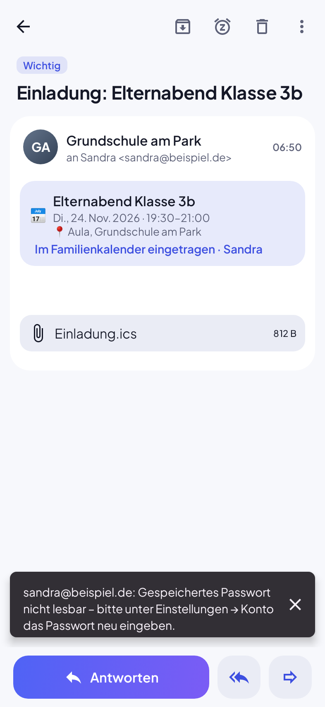 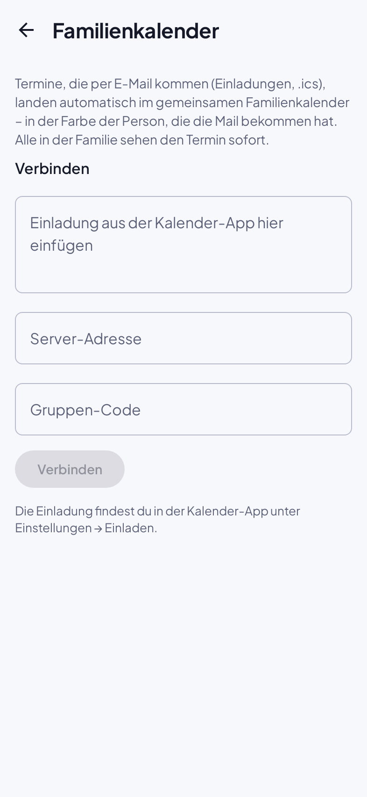 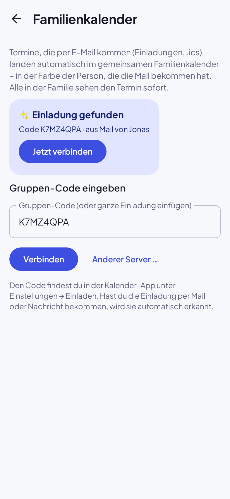

## Push, Updates, Konten später einrichten

- **Sofort-Benachrichtigung (Push):** Mailwerk hält per IMAP IDLE eine Verbindung zum Posteingang jedes Kontos offen –
  der Server meldet neue Mails sofort (im Test nach wenigen Millisekunden). Ohne Google-Server, ohne Cloud.
  Android verlangt dafür eine dauerhafte, unauffällige Benachrichtigung („Sofort-Benachrichtigung aktiv“), die man in den
  Android-Einstellungen ausblenden kann. Für zuverlässiges Push im Standby die Akku-Optimierung für Mailwerk ausschalten
  (die App fragt einmal danach). Unterstützt ein Server kein IDLE, wird jede Minute nachgesehen.
  Abschaltbar unter Einstellungen → Abgleich & Benachrichtigungen.
- **Updates (automatisch):** Die App prüft `update.json` in diesem Ordner, lädt neue Versionen im Hintergrund und installiert
  sie ohne Rückfrage (Android 12+; beim ersten Update nach einer Installation aus dem Browser fragt Android einmal nach).
  Danach kurz „Mailwerk wurde auf … aktualisiert ✓“. Abschaltbar unter Einstellungen → App. Android installiert nur APKs mit demselben Signaturschlüssel.
  Neue Version veröffentlichen: `versionCode`/`versionName` in `app/build.gradle.kts` erhöhen, bauen,
  `Mailwerk.apk` ersetzen und `update.json` anpassen.
- **Konten später einrichten:** Vorbereitete Konten lassen sich überspringen. Ein Hinweis im Posteingang und ein Eintrag
  unter Einstellungen → Konten erinnern daran, bis das Passwort eingegeben ist.

## Installation

1. `Mailwerk.apk` auf dem Handy herunterladen.
2. Öffnen → Android fragt einmalig, ob Installationen aus dieser Quelle erlaubt sind → erlauben.
3. App starten, Name, E-Mail-Adresse und Passwort eingeben → fertig.

**Vorbereitete Konten (optional):** Eine Datei `app/src/main/assets/preset_accounts.txt` mit Zeilen wie
`Max Mustermann|max@beispiel.de` anlegen und neu bauen. Die Konten erscheinen dann beim ersten Start fertig
eingerichtet – nur das Passwort fehlt noch. Die Datei ist per `.gitignore` vom Repo ausgeschlossen.

### Hinweise zu Anbietern
- **GMX / WEB.DE:** Im Web-Postfach unter *Einstellungen → POP3/IMAP Abruf* IMAP einschalten.
- **Gmail, iCloud, Yahoo, AOL:** Ein **App-Passwort** erstellen und statt des normalen Passworts verwenden.
- **Telekom (t-online.de):** Im E-Mail-Center ein eigenes E-Mail-Passwort für Mail-Programme anlegen.
- **Outlook.com / Hotmail:** Microsoft erlaubt bei privaten Konten oft nur noch die OAuth-Anmeldung. Dafür muss die App bei Microsoft registriert werden – das ist noch nicht eingebaut (siehe unten).
- **Eigene Domains** werden über den MX-Eintrag erkannt (one.com, IONOS, Strato, Google Workspace, Microsoft 365 …).

## Technik

- Kotlin, Jetpack Compose (Material 3), minSdk 26, targetSdk 35
- IMAP/SMTP über Jakarta Mail (Eclipse Angus), HTML-Bereinigung mit jsoup
- Lokale SQLite-Datenbank (offline lesbar), Hintergrundabgleich und zeitversetztes Senden über WorkManager

```
app/src/main/java/app/mailwerk/
  data/   Datenbank, Modelle, Repository (Abgleich, Aktionen, Versand), Verschlüsselung, Einstellungen
  mail/   IMAP/SMTP-Client, Einsortierung, Tracker-Blocker, Server-Erkennung
  sync/   Hintergrund-Worker, Benachrichtigungen
  ui/     Oberfläche (Posteingang, Unterhaltung, Verfassen, Konto, Einstellungen)
```

### Bauen
```bash
./gradlew assembleDirectRelease   # APK zum Weitergeben (aktualisiert sich selbst)
./gradlew bundlePlayRelease       # App-Bundle für den Play Store (braucht keystore.properties)
./gradlew testDirectDebugUnitTest # Tests
```
Signiert wird mit `app/mailwerk.keystore` (liegt bewusst im Repo, damit neue Versionen sich als Update über die alte
installieren lassen). Für eine Veröffentlichung im Play Store einen eigenen, geheimen Schlüssel verwenden.

### Tests
- `LogicTest` – Einsortierung, Unterhaltungs-Erkennung, Abmelde-Header, Tracker-Entfernung, Server-Erkennung
- `MailClientTest` – echter Durchlauf gegen einen lokalen IMAP/SMTP-Server (GreenMail): Anmelden, Ordner,
  Abgleich, Anhang laden, Gelesen-Status, Verschieben, Senden mit Anhang und Ablage in „Gesendet“
- `ScreenshotTest` – rendert die Oberfläche (Robolectric) und erzeugt die Bilder oben

## Noch nicht enthalten (mögliche nächste Schritte)
- Eigene Kalenderansicht, Exchange/ActiveSync, PGP/S-MIME-Verschlüsselung, Rich-Text-Editor, App-Sperre per Fingerabdruck
